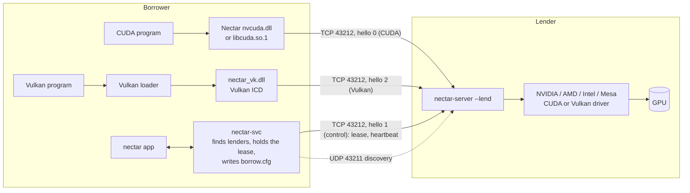

# Nectar

Lend a GPU over the network, and borrow it as if it were installed.

While a GPU is borrowed, CUDA and Vulkan programs on the borrower find it by themselves, with no launcher and no change to the program. A Vulkan program lists it as, for example, "NVIDIA GeForce RTX 5070 (Nectar)", next to the borrower's own GPU. When it's returned, or the lender goes away, programs see no GPU, as on a computer without one.

One app does it all. You choose what the GPU is for, **Gaming & rendering** or **AI & compute**, and Nectar tunes the link for that and tells you what would help most over your Wi‑Fi.

- [How it works](#how-it-works)
- [Platforms](#platforms)
- [Results so far](#results-so-far)
- [How it came together](#how-it-came-together)
- [Credits](#credits)
- [Testing still to do](#testing-still-to-do)
- [Plans](#plans)
- [Building](#building)

## How it works

### APIs, not hardware

Nectar carries **API calls**, not PCIe traffic or kernel driver calls. On the borrower, Nectar provides the driver each API's programs load:
- **CUDA:** an `nvcuda.dll` (Windows) or `libcuda.so.1` (Linux).
- **Vulkan:** a Vulkan loader driver (an ICD).

The lender runs each call on its GPU through its own, real driver. Each API is a **personality** on both sides. Everything else is shared: discovery, the shared secret, the lease, the upload cache and the transport.

WiCi measured why it has to be this level. At the kernel driver level, `nvidia-smi` alone took about 800 network round trips, 51× slower. At the API level, most calls can be sent without waiting at all.



### One app, two profiles

The `nectar` app, the service, the lender and the lease are shared, so one **Borrow** press gives a computer both drivers:
- **`nvcuda.dll`:** unmodified CUDA programs such as PyTorch and llama.cpp.
- **`nectar_vk.dll`:** Vulkan programs, and Direct3D games through DXVK and vkd3d-proton. It's also the route to AI on lenders without CUDA.

What the user chooses is the **profile**, which the app keeps and both drivers and the lender follow:

| | Gaming & rendering | AI & compute |
| --- | --- | --- |
| **Socket buffers** | 512 KiB up, 1 MiB down, so a frame's commands don't wait behind older data | 4 MiB each way, for results and tensors in bulk |
| **Wi‑Fi queue** | Video (AC_VI), which contends for the air sooner | Best effort (AC_BE), whose transmissions have no time limit but the frame's |
| **Link check's advice** | Room per frame, and whether the round trip fits a frame | Time per token, and a model's first load |

Either way, while a GPU is lent or borrowed over Wi‑Fi on Windows, both computers hold their Wi‑Fi in low-latency mode: media streaming mode on and background scans off, which last only as long as the lease's connection. Sockets are tuned as they connect, so a new choice reaches programs started after it.

The app shows how busy the lender's GPU is, as the heartbeat carries it: from NVML on NVIDIA, Windows' GPU counters on any vendor, or sysfs on Linux where the driver has it. For a program, `NECTAR_VK_STATS=1` adds where each frame's time went.

**Check link** measures the connection as tuned: round trips (typical, 1 in 20, worst), both directions' speed, what share was sent twice, and what each computer is connected by. It then says what would help, for the chosen profile.

The app says when a lender doesn't fit the choice: a lender with no CUDA means AI programs need a Vulkan build, and one with no Vulkan can't run games. `docs/architecture.md` has what limits each kind of work and the order of what's next.

### Lending and borrowing

- **The lender:** in the `nectar` app, **Lend this GPU** with a shared secret starts `nectar-server --lend`. The window shows who borrows the GPU, the traffic and the server's log.
- **Discovery:** the borrower broadcasts a probe on UDP 43211 with a nonce, a timestamp and an HMAC-SHA256 under the secret.
  - **Who answers:** only lenders that know the secret, each with its own HMAC over the borrower's nonce. So neither side trusts an impostor.
  - **The answer:** the lender's name, GPU vendor, OS and CPU, its state, and one line per API it lends (`api=cuda 13.5 official NVIDIA`, `api=vulkan ...`).
- **Connections** (TCP 43212): every connection starts with a challenge from the lender.
  - **Control connection** (hello 1): the borrowing service proves the secret and takes the **lease**, with a random token.
  - **CUDA and Vulkan connections** (hellos 0 and 2): programs prove the token.
  - **Not covered:** only the hello is authenticated. The calls after it are neither encrypted nor signed, so lend only on a network you trust.
- **The lease:** one borrower at a time.
  - **Heartbeats:** each way every second, carrying round-trip time, traffic and how busy the lender's GPU is, which the app shows.
  - **When heartbeats stop:** the borrower goes amber ("Reconnecting...") and keeps going for 20 s, so a short drop doesn't end anything. After that it goes grey ("No host available") and programs see no device. It borrows again by itself when the lender is back.
  - **On the lender:** the lease ends 30 s after the holder was last heard from with no connection open.
- **`borrow.cfg`:** the service writes it while a GPU is borrowed (`%ProgramData%\Nectar` or `/var/lib/nectar`), with the lender, the token and the APIs borrowed. The drivers read it. Users can read it; only SYSTEM or root can write it.
- **NVIDIA's hybrid runtime:** on Windows, CUDA's static runtime needs `nvcudart_hybrid64.dll`, which ships only with NVIDIA's display driver. The lender sends its own copy on the first borrow, into a sandbox keyed by its driver version. Nothing of NVIDIA's is installed system-wide on the borrower.

### The CUDA personality

- **Generated from `cuda.h`:** `codegen` runs bindgen over NVIDIA's public `cuda.h` and `cudaTypedefs.h`. It writes the types, function ids, the borrower's exports, the lender's dispatch and a tracer. Of the driver's 773 exports, 417 are generated, 33 are written by hand, 231 aren't supported yet and 92 are driver internals not in `cuda.h` (`native/nectar-cuda/codegen/report.md`).
  - Unsupported calls return `CUDA_ERROR_NOT_SUPPORTED` and log their name, instead of crashing.
  - The lender resolves every call by name through the real driver, so a driver update on the lender needs no change to Nectar.
  - After a new CUDA release, regenerating takes a run of the generator and a read of the report's diff.
- **`cuGetProcAddress`** is answered on the borrower from `cudaTypedefs.h`, with the driver's own rule: the newest variant not newer than the version asked for.
- **The runtime's private tables:** `cudart` won't start without undocumented tables from `cuGetExportTable`. The ten that ZLUDA documents, and the integrity check, are adapted from ZLUDA. Two newer ones were sized with Nectar's tracer, which observes the real driver's tables from outside: arguments, memory before and after, and results.
- **Kernels:** modules and libraries are sent as bytes. Parameter layouts come from `cuKernelGetParamInfo` / `cuFuncGetParamInfo` on the lender, cached by the borrower, never from driver internals.
- **Being loaded:**
  - **Installed:** System32's `nvcuda.dll` on Windows, or first in the library path on Linux.
  - **Without installing:** `nectar-cuda-run` loads Nectar's DLL into a program before it starts, and follows the processes it starts with a job object.
  - **On Windows:** NVIDIA's cuBLAS loads `System32\nvcuda.dll` by full path. So Nectar's DLL detours `LoadLibraryExW` (with retour) and answers any load of `nvcuda.dll` with itself.
- **Fewer waits** (`client/src/calls.rs`), which is what makes Wi‑Fi usable:
  - **No waiting:** calls that only queue work are sent without waiting, and their errors are reported at the next synchronize.
  - **Kept answers:** answers that can't change are kept, such as the context, device and kernel attributes.
  - **Batching:** requests are batched, and flushed when the borrower must wait, at 16 KiB, or after 1 ms.
  - **The upload cache:** uploads of 1 MiB or more go by content hash (XXH3-128). The lender keeps them on disk (20 GB, least recently used first out), so the second load of a model sends 16 bytes per tensor instead of 6.5 GB.
  - **No compression:** under LZ4, Q4_0 weights come to 99.6% and logits to 100.4% of their size, so it isn't worth it.
- **Safety:** the lender only runs a copy when both addresses are GPU memory. Otherwise, under unified addressing, a borrower's host address would be treated as the lender's own memory.

### The Vulkan personality

- **Generated from `vk.xml`:** `vkcodegen` reads Khronos' registry with roxmltree.
  - `vksys`: 2,430 types, with layouts checked against C sizes.
  - `vkwire`: a table describing every struct and command. One hand-written interpreter encodes and decodes them all, `pNext` chains included.
  - The lender's call thunks.
- **The borrower's driver** (`vk`, built as `nectar_vk.dll`):
  - **What it is:** a loader driver speaking interface version 5. While nothing is borrowed it lists no device.
  - **Which calls wait:** of 670 commands, 445 are sent without waiting, 220 wait for an answer, and 5 are waits the lender runs beside the ordered stream. A command is sent without waiting only when `VK_SUCCESS` is its only success code. Of the commands that can't be carried by the tables, descriptor update templates are read on the borrower and go up as the plain updates they stand for.
  - **Answered on the borrower:** what a physical device is and can do is kept after the first ask. Descriptor pools and layouts are counted, so an allocation that fits is sent without waiting and one that doesn't is refused at once; DXVK allocates sets for every draw.
  - **Extensions not offered:** those that pass addresses in the program's memory inside structs (descriptor heaps and buffers, host image copy, ray tracing), which mean nothing on the lender, and those about the swapchain or display, which are the borrower's. DXVK takes its ordinary paths without them.
  - **Design ideas from Mesa's Venus:**
    - **Handles:** the borrower chooses the ids of non-dispatchable handles, so creating one doesn't wait.
    - **Commands:** `vkCmd*` calls are recorded locally and sent with the submit.
    - **Kept answers:** properties, features and formats are fetched once and kept.
- **Mapped memory** is the hard part: the program writes to memory the GPU reads, and reads memory the GPU wrote.
  - **The shadow:** the borrower keeps a page-aligned copy of each mapping.
  - **Mapping:** nothing crosses. The shadow starts as zeros and stale, and the lender takes the borrower to hold zeros, so only pages that are touched and aren't zero ever come.
  - **GPU writes:** after a wait, the borrower's pages go **stale** (no access) instead of being fetched. The program's first touch of one fetches the stale pages around it: 1 MiB, doubling up to 64 MiB while it reads straight through. The lender (`FETCH`) sends only the pages the GPU changed. So a 566 MB staging buffer of which a token uses 1 MB costs 1 MB. A touch is caught by a vectored exception handler on Windows and a signal handler on Linux and macOS.
  - **Memory the GPU hasn't been given a way to write:** touching a stale page only makes it readable, with nothing fetched, so a game writing its constants into a mapped buffer each frame doesn't fetch them back first. What counts as a way to write is what's seen: copies, storage descriptors, transform feedback and images, and any buffer with an address once a shader appears that stores through an address (its SPIR-V is read for that). A buffer's usage flags say little, since allocators such as DXVK's make one huge buffer with every usage.
  - **Program writes:** only pages touched since the last wait can have been written. At submit, on Windows write watching (`MEM_WRITE_WATCH`) names them, and elsewhere they're compared by hash. Only those go up. Write protection would be exact too, but the system would then refuse to read a file into such a page.
  - **Waits for copies:** a submit that only copies into memory the program hasn't mapped is waited for on the borrower, as nothing the CPU can see depends on it, and the lender holds what comes after until the copy is done.
  - **Touching memory only asks the lender when something could have changed.** Each round trip is a whole wait, and Persona 4 Golden's 3D ran at 5 fps on the simulated link because 18 of them a frame fetched nothing. What the GPU can write is now followed by byte range, as DXVK makes one huge buffer of a whole allocation. A copy counts until it has finished and been fetched once. A storage descriptor counts only if a shader writes through that binding number, which is read from the SPIR-V, as DXVK uses them for read-only buffers too. That took it from 5 to 60 fps at 1024x768. At 2560x1440 on the simulated link it's a median of 73-77 fps against 121 natively, about 60-64%, worst 10% 63.
  - **What a copy writes for the CPU comes ahead of the news that it's done** (`vk/src/memory.rs`, `Pushing`). Each submit names what it writes in mapped memory, and the lender sends what changed just before it says the work is finished, so reading it needs no trip. A trip for each read-back waited behind everything going up, and at about 2 a frame that held The Witcher 3 to 13 fps walking. `vk-probe --read-back` checks the bytes against what was copied, with copies that overlap. `NECTAR_VK_PUSH=0` asks for them instead.
  - **A frame's quality goes by the time between the program's frames**, not by a fixed 12 ms: a game at 35 fps has 28 ms between frames to spend. It was also judged a frame at a time, coming down 5 for one frame over and going up 1 for one well under, so a link's jitter alone walked it down to about 20 at 2560x1440. It's smoothed over several frames now. Frames coming faster than 120 a second aren't given up quality for.
  - **How many frames are on their way at a time follows the program**, from 2 to 4. With 2, a frame that takes 50 ms to be asked for, rendered, coded, carried and drawn held The Witcher 3 to 40 fps whatever else was quick, and the same sum comes to Persona 4 Golden's 74. While the program waits in present for one to finish, one more is tried, and kept only if frames then come at least 5% faster: if they don't, something on the way can't keep up, and more at once would only queue there. `NECTAR_VK_FRAMES` fixes how many.
  - **Descriptor copies go together** (`vkwire/src/descriptor_copies.rs`). Without descriptor buffers, which can't cross to the lender, vkd3d-proton copies descriptors one call at a time: The Witcher 3 makes about 650,000 of these a second. They now wait for what could depend on them and go as one short message and one driver call, which took it from about 24 to about 35 fps at 2560x1440. `NECTAR_VK_COPY_DESCRIPTORS=1` sends each as it comes.
  - **Only memory something could have changed goes stale.** The Witcher 3's threads marked every mapping stale about 650 times a second, under the lock that every touch needs, and took about 40 faults a frame on upload rings the GPU never writes. A copy still running no longer counts as changed either, as the program can't be expecting it, and about 65% of asks came from that and brought nothing back.
  - **What vkd3d-proton keeps asking stops crossing.** What an image needs of memory depends only on how it's created, so each way of creating one is asked once (`vk/src/requirements.rs`); The Witcher 3 spent about 100 s of its load on these, and its first frame went from 124 s to 20 s. Direct3D 12's upload heaps are never fetched back, as nothing on the GPU writes them. A timeline's value is answered from the news on its way. Shader module identifiers aren't offered. 
  - **The stream's compression reaches back 256 MiB** (`protocol/src/pack.rs`), in a ring so that nothing ever has to slide. The Witcher 3 writes about 9 MB a frame, half of it foliage: 16-byte records that come back each frame in another order, some of them from over a second before. At 8 MiB that came to about 2 MB a frame, and now it's about 1 MB. It costs 256 MiB on each side as it fills. Blocks are packed on up to 4 threads (`NECTAR_PACK_THREADS`), which halved the time compressing takes, to 12-14 ms a frame, at about 15% more bytes. That made no difference to The Witcher 3's frame rate that could be told from the runs' own spread, so it isn't a limit on its own.
  - **The lender's stream thread does less for each message.** Handles hash quickly, and buffers are used again rather than allocated, as a game sends tens of thousands a frame: this thread was busy in 31 of 36 samples, nearly all of it not GPU work. Frames are coded and decoded by threads that stay rather than a dozen that start and end each frame.
  - **A fetch doesn't hold the memory lock across its trip**, which froze every thread that touched memory or finished a wait. Whoever wants those pages meanwhile waits for them.
  - **A texture's large mips can come later** (`vk/src/later.rs`), so a game doesn't stop for a texture it's seeing for the first time. The copy goes ahead with the lender's stand-in, made by repeating blocks from the mip below or a small sample, and the real mips follow in the background, smallest first, leaving room for the game's traffic. A 358 MB texture stops the game for 406 ms instead of 4.8 s, and is sharp after about 15 s. Anything that would notice waits for the real mips first. `NECTAR_VK_MIPS_LATER=0` turns it off.
  - **On a slow link, large mips cross twice** (`vkwire/src/wavelet.rs`, `vkwire/src/bc.rs`): first coded by a wavelet, about 6 to 8 times smaller, which the lender turns back into blocks off the stream, then as their real bytes. An 87 MB texture on a link 20 dB weaker looks right after 3.1 s, where its real bytes take 14 s. The driver measures what's getting through and doesn't bother on a good link. `NECTAR_VK_WAVELET=0` or `1` overrides it.
  - **Large writes** go by content hash with no wait, so a texture or model that's been seen before costs only hashes, wherever it sits in staging memory. Where the copy that reads them is known they're hashed exactly as it reads them (`vk/src/uploads.rs`). Otherwise they're cut where their content says, about 96 KiB at a time, as DXVK writes a texture before it records the copy. The lender keeps them on the same cache as CUDA's, and what a game rewrites each frame isn't kept. A 358 MB BC7 texture repeated goes from 360 MB to 978 KB on the link.
  - **`NECTAR_VK_EAGER=1`** fetches after every wait instead, for programs that hand stale mapped memory to the system.
  - **Memory types:** GPU memory the CPU can map (resizable BAR) is offered as GPU-only, since the lender's CPU would read it over PCIe. Integrated GPUs keep their memory types as they are.
- **Frames on screen** (`vk/src/present.rs`, `vk/src/window.rs`): the swapchain is the borrower's.
  - **The images** are ordinary images on the lender, which the program renders into as usual. The lender needs no window or display.
  - **On present,** a copy goes to a buffer the lender's CPU can read, and the request for the frame goes straight after it, so a frame costs one trip across the link rather than one for the copy and one for the frame. The lender waits for the copy and codes the frame on a thread of its own. A thread on the borrower draws answers in the window as they come: with GDI on Windows, and over an X connection of its own on Linux (Xlib and XCB surfaces).
  - **The frame codec** (`vkwire/src/frame.rs`) is Nectar's own, in portable Rust, so any lender can send frames and any borrower can show them. It cuts a frame into 64x64 tiles, skips unchanged ones, and codes the rest much as JPEG does.
  - **Frames are coded on the lender's GPU** (`vkwire/src/frame_shader.rs`), by three compute shaders written with a small SPIR-V writer (`vkwire/src/spirv.rs`), so there's no shader compiler to install. They compare tiles, transform each 8x8 block, then write the bits, visiting only coefficients that aren't zero. They write the same format as the CPU coder, which stays for lenders with no real GPU and for `NECTAR_VK_FRAME_CODER=cpu`. The start of each tile's output is written in the GPU's own memory and copied across in one go, as writing a word at a time across PCIe manages about 540 MB/s.
  - **Where the lender's card has a video encoder, frames go as H.264 instead** (`vkwire/src/video_encode.rs`, through Vulkan Video, which NVIDIA, AMD and Intel drivers all offer the same way).
    - **On the lender's GPU:** a compute shader makes the frame's NV12 (`vkwire/src/video_shader.rs`), and the card's encoder makes a picture of it coded against the one before. The lender adds the encoder's queue and extensions to the device as it's created, which the program never sees, and creates it as asked if the driver won't have them.
    - **On the borrower:** the decoder Windows comes with (`vkwire/src/video_decode.rs`, Media Foundation), so nothing is installed. Linux and macOS borrowers have no decoder wired up yet and keep the tile coder.
    - **The stream:** one picture in, one out, none out of order, so each is shown as it arrives. A key frame comes first, and again if a picture can't be decoded.
    - **Measured at 2560x1440 on the RTX 5070 (`vk-probe --video`):** a frame of a moving test picture is 3 to 15 KB, where the tile coder's is 270 KB to 1.5 MB. Making the NV12 takes about 1.7 ms, encoding 3.5 to 4.5 ms, and decoding 5 to 7 ms on a Ryzen 7 5800X. The heaviest test picture at the finest quality is 228 KB and takes 18 ms to decode, so what a picture takes to decode beyond the quickest lately counts in what the quality goes by.
    - **Not yet measured in a game.** `vk-probe --present` shows the right colours through the simulated link. Its frames, one flat colour each, are the tile coder's best case: at 2560x1440 video ran at 82 fps against 96 with tiles, as decoding took 11 ms a frame on the CPU, on the one thread that draws, with the lender and the simulator on the same PC. At 1280x720 both ran at about 105.
    - **`NECTAR_VK_FRAME_CODER=tiles`** on the borrower keeps the tile coder, and `NECTAR_VK_VIDEO=0` on the lender leaves the encoder out.
  - **Two frames are on their way at a time** (`NECTAR_VK_FRAMES`), so the time for a trip doesn't limit the frame rate. It's only two so that frames can't queue up: a program that renders faster than the link carries waits in present. Swapchains get an extra image for it.
  - **The quality follows what it can change:** how long a frame takes to code, and how long its bytes take to arrive once they start. The time for a trip across is the same at any quality, and is left out.
- **Fewer waits and fewer bytes over a link** (lender on another computer, or `NECTAR_VK_KEEP_UPLOADS=1` and `NECTAR_VK_PACK=1`):
  - **Pipelines** (`server/src/vulkan.rs`) are answered at once, and compile on the lender on threads of their own, so a slow compile doesn't hold up the frames behind it. Only what uses a pipeline waits for it. What a compile reads, which the program may destroy as soon as it thinks the pipeline exists, is destroyed once no compile is running. A program that asks to be told how a compile went still waits. `NECTAR_VK_WAIT_PIPELINES=1` waits for them all.
  - **Shader code** goes by content hash, whether in a shader module or chained on a pipeline's stage, so a game's shaders cross once. The lender keeps them in one file (`shaders.pack`, in the upload cache): a file for each took longer than sending them.
  - **Timeline semaphores** (`vk/src/timelines.rs`): each submit that signals one also asks the lender to say when that value is reached, so the news is on its way before anyone waits. DXVK waits three times a frame, and these waits now cost the trip one way at most. `NECTAR_VK_WAIT_SEMAPHORES=1` asks the lender each time.
  - **Everything going up is compressed** (`protocol/src/pack.rs`): an LZ of Nectar's own, whose 8 MiB window spans blocks, so a frame's commands are copied from the frame before's. It tries the same offset as the last match first, since calls change a few values and keep the rest. Bytes that don't compress go as they are and stay out of the window. On its synthetic test 4.3 GB/s packing and 8.5 GB/s unpacking on one thread; on real commands it takes about 1.4 ms a frame.
  - **Sending has a thread of its own** (`vk/src/connection.rs`), so neither compressing nor a full link holds up the program's frame, until 16 MiB is waiting. The program's thread spends about 0.2 ms a frame on it.
- **The lender** loads the system's Vulkan loader, replays each submit into real command buffers, and frees whatever a borrower leaves behind, crashed or not. It reads mapped memory with streaming loads where the CPU has them, since memory for uploads is usually write-combined, which ordinary reads cross at about 100 MB/s. That alone took Persona 4 Golden's movie from 13 to over 70 fps.

### Detecting GPUs and drivers

`nectar-detect` lists each GPU with its vendor and PCI ids, VRAM and kernel driver, and each API its drivers offer, with version and conformance.
- **APIs checked:** CUDA, Vulkan, OpenCL, HIP and Level Zero.
- **Where each comes from:** official, community (Mesa's NVK, RADV, ANV, Honeykrisp, ...), software (lavapipe) or remote (Nectar). Vulkan drivers report this through `VkDriverId`.

The lender's discovery answer and the app's Lend screen use it.

### The code

Everything is in `native/nectar-cuda`, a Rust workspace. Its README has the settings, the tracer and the details of each crate.

| Crate | What it is |
| --- | --- |
| `protocol` | Framing, function ids, hellos, kept answers |
| `lending` | Discovery, the secret, the lease, `borrow.cfg`, the hybrid sandbox, the profiles, Wi‑Fi tuning and the link check |
| `client` | The borrower's CUDA driver |
| `vk`, `vkwire`, `vksys` | The borrower's Vulkan driver, its wire format and types |
| `server` | `nectar-server`: the lender, with a CUDA and a Vulkan personality |
| `svc` | `nectar-svc`: the borrowing service (Windows service or systemd) |
| `app` | `nectar`: a window on Windows, a command elsewhere |
| `detect` | `nectar-detect` |
| `redirect`, `run`, `trace` | Windows: the `LoadLibrary` redirect, the launcher, the call tracer |
| `probe`, `vkprobe` | `cuda-probe` and `vk-probe`, end-to-end checks |
| `netsim` | `nectar-netsim`: a simulated Wi‑Fi link on one computer, with rate limits, delay, jitter, lost packets, attenuation and fades |
| `codegen`, `vkcodegen` | The generators, not part of the normal build |
| `install/` | The borrower's installers for Windows, Linux and macOS |
| `tests/wifi/` | The over-Wi‑Fi test kit: a bundle for the borrower, the lender's script, and the borrower's test |

## Platforms

✅ tested · 🟡 built or partly tested · ⬜ planned

| | Lender | Borrower |
| --- | --- | --- |
| **Windows x64** | ✅ CUDA, ✅ Vulkan | ✅ CUDA (over Wi‑Fi), ✅ Vulkan and frames in a window (loopback; Wi‑Fi next) |
| **Linux x64** | ✅ CUDA (in WSL, on NVIDIA's WSL driver), ✅ Vulkan (in WSL, on lavapipe) | ✅ CUDA, ✅ Vulkan and frames under X (in WSL); Wayland-only desktops not yet |
| **Linux arm64** | 🟡 should build; waits for a cross-compiler | 🟡 same; to run under qemu, then on a Raspberry Pi 5 |
| **macOS (Apple silicon)** | 🟡 Vulkan over KosmicKrisp or MoltenVK; written, never built on a Mac | 🟡 Vulkan compute, with `install-borrower-macos.sh`; written, never built on a Mac. No frames yet, and there are no CUDA programs on macOS |
| **Windows on Arm** | ⬜ | ⬜ x64 programs under emulation, then a native ARM64X `nvcuda.dll` |
| **Android** | ⬜ | ⬜ Vulkan, for programs that load their own driver |

Lenders and borrowers mix: a Windows program has run on a Linux lender, and a Vulkan program on Windows has run on Mesa's lavapipe in Linux. One GPU vendor has been lent so far (NVIDIA, plus lavapipe in software). Nothing in the Vulkan path is NVIDIA's, and frames need nothing of any vendor's; Intel Arc lending is the next test, from the laptop.

A PC with NVIDIA's own driver can borrow too, through Vulkan: its CUDA programs keep its own GPU.

**Not supported, by design:**
- **Metal programs on macOS:** Metal assumes Apple's GPU.
- **Direct3D programs on Windows without a translator:** Direct3D only reaches a GPU through a WDDM kernel driver. See the plans for DXVK and vkd3d-proton.
- **Games with anti-cheat.**

## Results so far

Gemma 4 12B (Q4_0) in llama.cpp, on the desktop's RTX 5070. The chat test asks a fixed question with greedy sampling, and the answer must match the native one byte for byte.

**CUDA over Wi‑Fi** (laptop with Intel Core Ultra 9 288V on Wi‑Fi 7, desktop on Wi‑Fi 6E, 6 ms round trip, 70 MB/s up, 41 MB/s down):

| | Native on the lender | Borrowed by the laptop |
| --- | ---: | ---: |
| llama-bench pp512 | 3517 t/s | 1391 t/s (40%) |
| llama-bench tg128 | 76.5 t/s | 24.0 t/s (31%) |
| llama-server chat | 73.7 t/s | 20.8 t/s (28%), byte-identical |
| Model load | – | 95 s the first time, 11 s from the lender's cache |

A token costs about 42 ms against 13 ms natively: one round trip plus its 1 MiB of logits over the lender's Wi‑Fi upstream, which is now the limit.

**Vulkan over loopback** (llama.cpp b12030):

| | Native | Through Nectar |
| --- | ---: | ---: |
| llama-bench pp512 | 2653 t/s | 2560 t/s (97%) |
| llama-bench tg128 | 62.7 t/s | 59.5 t/s (95%) |
| llama-server chat, 506 tokens | 60.0 t/s | 87%, byte-identical |

Answering copies' waits on the borrower, and not fetching what the GPU can't have written, took a short run's (32 tokens) fence waits from 1,091 to 35 and its page fetches from 1,915 to none. The fence polls, about 23 per token, remain: they overlap the GPU's work, but each is a round trip. Nectar hasn't measured Vulkan over Wi‑Fi yet.

**A Vulkan model load** (`llama-bench`, on loopback with the upload cache forced on):

| | Sent to the lender | Received from it |
| --- | ---: | ---: |
| Before lazy mapping and the cache | 6,973 MB every load | 832 MB every load |
| First load now | 6,972 MB | 2 MB |
| Next load now | 84 MB | 2 MB |

**Frames** (Nectar's driver, loopback, RTX 5070):

| | Frames per second | Coded frame |
| --- | ---: | ---: |
| vkcube, 500x500 | about 350 | 23 KB, from 1 MB raw |
| `vk-probe --present`, 1920x1080, every pixel changing colour | 131 | |

**A real game: Persona 4 Golden**, a 64-bit Direct3D 11 game, unmodified, from a copy with DXVK 3.1.1 beside it, at 2560x1440 on the RTX 5070, over loopback. Its movie, menus and 3D town all draw correctly, and keyboard input works, as the game's window is the borrower's own.

**A heavier game: The Witcher 3**, the Direct3D 12 remaster, unmodified, from a copy with vkd3d-proton 3.1 and DXVK's DXGI beside it, loads a save and plays on the simulated measured link. At 2560x1440, walking through a forest with ray tracing and sharpening off, it gives a median of 36.7 fps, worst 10% of samples 30.9, against about 47 on Direct3D 12 itself, where the GPU is 96% busy. That's about 78% of native. From an empty cache it's 33.3 and 29.1. Those figures had the frame coder at a quality of about 10-30, and 2 frames on their way at a time. Both have changed since (below), and one run with the new quality budget and 3 frames on their way gave a median of 44.7 fps, worst 10% 34.5, at a quality of about 50. That's one run, before the count of frames on their way was made to follow the game by itself, which no game has run with yet. vkd3d-proton directly on the GPU crashes inside NVIDIA's driver within 16 s, with no Nectar involved, so native here means Direct3D 12.

| | DXVK directly | Through Nectar | GPU busy, through Nectar | Up and down per frame |
| --- | ---: | ---: | ---: | ---: |
| Menus | about 120 fps (the game's cap) | about 100 fps | about 40% | 200 KB, 60 KB |
| Opening movie | about 120 fps | 70–87 fps | 15–32% | 1.1–1.4 MB, 300 KB |
| 3D town | about 120 fps | about 28 fps | 14–20% | 3.2 MB, 200–400 KB |

In the 3D town the GPU is far from the limit: what limits it is the 3 MB the game writes each frame, with about 20 touches of stale pages costing about 30 ms. Over Wi‑Fi at the 70 MB/s measured up, those 3 MB alone would allow about 23 fps. Wi‑Fi hasn't been tried.

One run, before a race was fixed that could lose a page the game wrote just as pages went stale, hung the GPU: the lender got `VK_ERROR_DEVICE_LOST` and Windows' display driver reset. DXVK directly didn't do this. The next run, on the same path with the race fixed, went through without a reset, which is suggestive and not proof.

**A Direct3D 11 test program through DXVK 3.1.1** (`tests/d3d11_probe.cpp`: real shaders and a texture, with `Map(DISCARD)` before each draw; loopback, RTX 5070, checked on screen):

| Draws per frame | Size | DXVK directly | Through Nectar |
| ---: | --- | ---: | ---: |
| 500 | 1280x720 | | 173 fps |
| 2,000 | 1280x720 | | 71–94 fps |
| 2,000 | 1920x1080 | 1,174 fps (with 256 KiB uploaded per frame) | 61 fps; 49 fps with 256 KiB uploaded per frame |
| 10,000 | 1920x1080 | | 16 fps |

At 2,000 draws a frame holds about 1.5 MB of commands going up, and 100 KB comes down.

**The GPU frame coder** against the CPU's, on the RTX 5070, on a picture with fine detail, at sizes the measured link can carry at 120 fps. Same format, same size and same picture to within 0.01 dB. The target is 0.833 ms, a tenth of a frame at 120 fps:

| | GPU | Gathering on the CPU | CPU coder, on 16 threads |
| --- | ---: | ---: | ---: |
| 1920x1080, 266 KB | 0.77 ms | 0.08 ms | 4.5 ms |
| 2560x1440, 287 KB | 1.27 ms | 0.10 ms | 6.9 ms |

So 1080p is about on target and 1440p is over. In real programs, the time on the lender per frame, including the copy and waiting for the fence, went from 4.7 to 1.0 ms at 1080p and from 6.7 to 1.3 ms at 1440p, and the lender's CPU is left nearly idle.

**Through a simulated link** (`nectar-netsim`, on this desktop, lender and borrower both on the RTX 5070's computer). `measured` is the rate and delay the laptop and desktop measured over real Wi‑Fi. The weakened and busy links are estimates, and none of this has crossed real radios yet:

| | Round trip | Up / down | Direct3D 11, 2,000 draws, 1280x720: before | After |
| --- | ---: | ---: | ---: | ---: |
| `measured` | 8.8 ms | 68 / 37 MB/s | 26 fps | 97 fps |
| `measured`, 20 dB weaker | 13.7 ms | 24 / 13 MB/s | 11 fps | 69 fps |
| `busy` | about 20 ms | 25 / 20 MB/s | 10 fps | 54 fps |
| `measured`, fading by up to 30 dB every 6 s | | | | 84 fps, 73–103; quality fell to 50 in the worst of it and came back |

"Before" already had frames overlapping. What took it from 26 to 97 fps was compressing what goes up, from 1,470 KB to about 115 KB a frame (13 times), and answering semaphore waits on the borrower.

| Same link, `measured` | Before | After |
| --- | ---: | ---: |
| `vk-probe --present`, 1280x720, a colour each frame | 41 fps | 99 fps (the program waits for a fence each frame) |
| The same, 20 dB weaker | 26 fps, at quality 10 | 62 fps, at quality 90 |
| 500 pipelines: time until the program can go on | 4.4 s | 1.4 ms |
| Shaders sent going up, second run of 2,000 | 9.3 MB | a hash each |

llama.cpp through `measured`: CUDA tg 26% of native and chat 27%, against 31% and 28% on the real Wi‑Fi link earlier, so the simulator is near what real radios gave. Vulkan tg 26% and chat 17%. Chat answers matched word for word on both.

What compression can't do: model weights hardly compress (7.1 GB to 7.0 GB), and each token needs its answer back, so AI work gains little from this. Persona 4 Golden hasn't been run through the simulator.

The codec at 1920x1080, on a picture with noise added, the worst kind (16 threads): 3–5 ms to encode, 2–3 ms to decode, 220 KB to 958 KB per frame depending on quality. Over Wi‑Fi these are untested. At the 41 MB/s measured down, 220 KB allows about 180 frames per second, so the link should not be what limits a frame.

PyTorch (a cuBLAS matmul and an elementwise kernel) and a CUDA runtime program also pass through Nectar, on loopback.

## How it came together

1. **Juice as the baseline:** Nectar began as a fork of Juice Labs' GPU-over-IP repository.
   - **What worked:** Juice's 2023.08.10 release rendered vkcube and the Quake II remaster on the RTX 5070, and vkcube over Wi‑Fi.
   - **What didn't:** its closed CUDA remoting depended on driver internals and failed on CUDA 13.5. Its Vulkan driver ended the program on any server error, so it couldn't be left installed.

   Juice's runtime is closed and its terms forbid redistribution and reverse engineering, so Nectar couldn't build on it.
2. **WiCi showed the way for CUDA:** remote the CUDA *driver API*, parse fatbins, and never depend on driver internals. Nectar implemented that design in Rust, in the open, under a clean-room rule: public headers and open-source projects only, with no NVIDIA or Juice binary disassembled.
   - **First:** a spike of 19 hand-written calls showed the RTX 5070 to a remote `cuda-probe`.
   - **Generator:** the generator from `cuda.h` followed.
   - **The runtime:** to start the CUDA runtime, ZLUDA's documented tables, plus a black-box tracer for the two that nobody had documented.
   - **PyTorch** needed host memory and two cuBLAS profiling hooks.
   - **llama.cpp** needed the `LoadLibrary` redirect, because cuBLAS loads the real driver by full path.
3. **The first Wi‑Fi run crawled:** 61 round trips per token and 14.9 t/s prompt processing. Sending without waiting, kept answers, batching and the upload cache brought it to about one wait per token, and the second Wi‑Fi run passed, with 28–40% of native and an identical answer.
4. **Lending became an app:** a lender window, a borrowing service, discovery with a shared secret, a lease with a grace period, and an installer. With them, CUDA programs find the borrowed GPU with no launcher.
5. **General purpose:**
   - `nectar-detect`, vendor-neutral discovery, and portable crypto.
   - A Linux port of all of it.
   - A Windows program borrowing from a Linux lender (llama.cpp, from WSL).
6. **Vulkan, the cross-vendor API:** the second personality, generated from `vk.xml`.
   - **Venus's ideas:** client-chosen handles and recorded command buffers.
   - **Mapped memory:** write watching and stale pages, after hashing a 566 MB staging buffer cost 70 ms per wait.
   - **The result:** llama.cpp's Vulkan backend reached 88–95% of native on loopback, with an identical answer.
7. **Juice removed:** none of its code was in use any more, so it was deleted. It's credited below, and its history stays in git.
8. **One app for both kinds of work:** a choice of profile that tunes sockets and Wi‑Fi, a link check that says what to do about the link, and frames on screen from any lender through a codec of Nectar's own.

## Credits

Nectar builds on other people's work: some it uses, some it adapts, and some it learned from. Each project keeps its own license.

### Inspiration and design

- **[Juice Labs](https://github.com/Juice-Labs/Juice-Labs)** (MIT, 2023): GPU-over-IP for any application. Nectar started as a fork of their repository, and their 2023.08.10 release was the first baseline. No Juice code or binaries remain, and none were disassembled.
- **WiCi** (Shen et al., [arXiv 2608.24204](https://arxiv.org/abs/2608.24204), 2026): the CUDA remoting design. The ideas Nectar took from it:
  - Intercept the CUDA driver API.
  - Take kernel parameters from the public API, not driver internals.
  - Batch calls and keep uploads on the lender.

  Its setup, a consumer GPU on Wi‑Fi, is Nectar's own, and its measurements ruled out a kernel-level forwarding driver.
- **[Mesa's Venus](https://docs.mesa3d.org/drivers/venus.html) and virglrenderer** (MIT): the Vulkan wire design. Nectar took client-assigned handles, recorded command buffers, answers kept locally, and blocking waits beside the ordered stream. No Venus code is used.
- **NVIDIA GPUDirect and NCCL:** the idea of pipelining large copies through pinned buffers (planned).

### Adapted code

- **[ZLUDA](https://github.com/vosen/ZLUDA)** (MIT/Apache-2.0): the CUDA runtime's private tables and their integrity check, with its test vectors, are adapted from ZLUDA. See `native/nectar-cuda/LICENSE-ZLUDA`. ZLUDA is also the planned way to lend an AMD GPU to CUDA programs, as the lender's CUDA driver.

### Specifications and headers

- **NVIDIA's public CUDA headers** (`cuda.h`, `cudaTypedefs.h`, under NVIDIA's license): the source of the generated CUDA bindings. Nectar's CUDA side is built from these and from NVIDIA's documentation only.
- **Khronos' [Vulkan-Headers](https://github.com/KhronosGroup/Vulkan-Headers)** (`vk.xml`, Apache-2.0 or MIT), the Vulkan specification, and the [Vulkan loader](https://github.com/KhronosGroup/Vulkan-Loader)'s driver interface.

### Used for testing

- **[DXVK](https://github.com/doitsujin/dxvk)** (zlib): Direct3D 9, 10 and 11 on Vulkan. This is how Direct3D games reach a borrowed GPU on Windows. The laptop bundle carries its release.
- **[llama.cpp](https://github.com/ggml-org/llama.cpp)** (MIT): the main workload, through its CUDA and Vulkan backends. The model is Google's Gemma 4 12B.
- **[PyTorch](https://pytorch.org)** (BSD-3-Clause).
- **[Mesa](https://mesa3d.org)'s lavapipe** (MIT): a software Vulkan lender in Linux.

### Rust crates

| Crate | License | Used for |
| --- | --- | --- |
| [retour](https://crates.io/crates/retour) | BSD-2-Clause | The `LoadLibraryExW` detour |
| [xxhash-rust](https://crates.io/crates/xxhash-rust) | BSL-1.0 | Content hashes for the upload cache and pages |
| [hmac](https://crates.io/crates/hmac), [sha2](https://crates.io/crates/sha2), [getrandom](https://crates.io/crates/getrandom) | MIT/Apache-2.0 | The shared secret |
| [libloading](https://crates.io/crates/libloading) | ISC | Loading GPU drivers |
| [windows-sys](https://crates.io/crates/windows-sys), [libc](https://crates.io/crates/libc) | MIT/Apache-2.0 | The operating systems |
| [roxmltree](https://crates.io/crates/roxmltree) | MIT/Apache-2.0 | Reading `vk.xml` (generator) |
| [bindgen](https://crates.io/crates/bindgen) with libclang | BSD-3-Clause; Apache-2.0 with LLVM exception | Reading `cuda.h` (generator) |
| [syn](https://crates.io/crates/syn), [quote](https://crates.io/crates/quote), [proc-macro2](https://crates.io/crates/proc-macro2), [prettyplease](https://crates.io/crates/prettyplease), [object](https://crates.io/crates/object) | MIT/Apache-2.0 | The CUDA generator |

### Planned: games and other platforms

These aren't used yet; the plans below rest on them.
- **[vkd3d-proton](https://github.com/HansKristian-Work/vkd3d-proton)** (LGPL-2.1): Direct3D 12 on Vulkan.
- **[Proton](https://github.com/ValveSoftware/Proton)** (Valve): on Linux, it already runs Windows games on Vulkan. With Nectar's driver installed as a system Vulkan driver, those games need no change at all.
- **[FEX](https://github.com/FEX-Emu/FEX)** (MIT): x86 programs on ARM64 Linux, as inside Proton's ARM64 builds. It carries the same path to ARM devices.
- **[Mesa's Zink](https://docs.mesa3d.org/drivers/zink.html)** (MIT): OpenGL on Vulkan.
- **[KosmicKrisp](https://docs.mesa3d.org/drivers/kosmickrisp.html)** (Mesa, MIT) and **[MoltenVK](https://github.com/KhronosGroup/MoltenVK)** (Apache-2.0): Vulkan on Apple GPUs, for a Mac lender. Also LunarG's Vulkan SDK for macOS, for building there.
- **[ProtonDB](https://www.protondb.com)** (its data under ODbL) and **[AreWeAntiCheatYet](https://areweanticheatyet.com)**: which games to test, and which to leave out.

## Testing still to do

**Next, with what's here now:**
- **The Wi‑Fi run:** the laptop borrows the RTX 5070 with the current bundle (`native/nectar-cuda/tests/wifi`). It also tests things that have only run on loopback so far:
  - The installed borrower: `Install-Borrower.ps1`, the service under Windows' service manager, and the Vulkan driver registered with the loader.
  - CUDA programs with no launcher at all.
  - Each profile's effect, measured by the link check: whether smaller buffers and the video queue steady the round trip, and whether larger buffers lift the 41 MB/s.
  - Low-latency mode: it has never been switched on. It's kept away from loopback, and I didn't turn it on on this desktop.
  - Frames over the air: frame rate and quality in a window on the laptop.
- **Longer play:** Persona 4 Golden has run for only a few minutes, on the desktop, and only one run since the fix for the GPU hang. Heavier games, such as Hellblade, are next.
- **Drops on the installed borrower:**
  - A 2 s Wi‑Fi drop stays green or amber and recovers.
  - A long drop goes grey, programs see no GPU, and it borrows again when the link is back.
  - `-Uninstall` leaves nothing behind.
- **A second vendor:** the desktop borrows the laptop's **Intel Arc** through Vulkan.
- **Vulkan conformance:** Khronos' CTS (dEQP-VK `api.*` and `memory.*`) over loopback on Windows and in WSL, with failures listed, not hidden.
- **Regression on each change:** `cuda-probe`, `vk-probe`, `runtime_probe.cu`, `torch_probe.py` and the llama.cpp chat on both APIs. `cargo test` and `clippy` on Windows and Linux.

**Needs other machines:**
- **The Mac** (Apple silicon), over SSH from the desktop:
  - Borrowing the RTX 5070 from an ARM64 macOS program.
  - Lending the Apple GPU to Windows through KosmicKrisp.
- **Linux on real hardware:** `install-borrower.sh` and the systemd service outside WSL, and discovery by broadcast, which doesn't reach into WSL.
- **arm64 Linux:** cross-built and run under qemu, then on a Raspberry Pi 5.
- **Windows on Arm:**
  - x64 CUDA programs under emulation, and whether the `LoadLibrary` detour works there.
  - Then native Arm64 programs.
- **An AMD GPU:** HIP, and CUDA programs through ZLUDA on the lender.
- **A different-version hybrid runtime:** whether a Windows borrower can use one from a lender whose driver version differs, or one from a Linux lender.

**Known gaps to close and then test:**
- **Linux and macOS program writes:** pages touched since the last wait are hashed at each submit, which a large mapped buffer the GPU can't write would pay for on every submit.
- **Stale pages:** a program that passes stale mapped memory to the system (for example `WriteFile`, or `read()` on Linux) fails. `NECTAR_VK_EAGER=1` is the workaround.
- **An old Vulkan loader:** vkcube with the very old loader bundled beside it hung before opening its window, after Nectar began making its own surfaces. With the system's loader, which programs normally use, it runs.
- **Input-to-photon latency:** not measured yet.
- **32-bit games:** DXVK's 32-bit build needs a 32-bit Vulkan driver, and Nectar's is 64-bit only. So games such as Shadow Tactics, Ori and Metro Last Light can't run yet.
- **Wayland and macOS windows:** frames need a Wayland path for Wayland-only desktops, and a Metal one for the Mac.
- **More than one borrower:** it needs fair sharing on the lender first.

## Plans

`docs/architecture.md` sets out what limits each kind of work, including the ideas parked and why.

**AI:**
- **The link first:** Ethernet on the lender, and what the link check finds on the real Wi‑Fi, before changing the transport.
- **Generation on the lender (open):** a second mode that runs an engine such as llama-server on the lender. It should run near native speed, but its programs talk to a server and don't see a GPU.

**Gaming and rendering, frames:**
- **Video frames, the rest:** decoding on the borrower's own GPU and drawing from there, which takes the CPU out of it. Decoders for Linux (VA-API) and macOS (VideoToolbox) borrowers. H.265 and AV1 where both ends have them. UDP and error correction for frames.
- **Wayland and Metal windows.**
- **Measuring** frame rate and input-to-photon latency on the laptop and the Mac.

**Gaming and rendering, games:**
- **Compile ahead:** the lender records each game's pipelines and compiles them in the background at its next launch, as Fossilize does for Steam, with nothing needed from the game or a store. Microsoft's Advanced Shader Delivery can't serve here: it works in the Direct3D 12 runtime, which vkd3d-proton replaces, and delivers shaders for the borrower's GPU rather than the lender's.
- **Textures and heavy writes:** `docs/texture-streaming.md` has the research and measurements. A repeat now costs a hash and a large new texture no longer stops the game, but it takes the link's time to arrive, and the wavelet that helps on slow links runs on the CPU, where compute shaders would be quicker. Then coding rewritten buffers as a difference from the last frame, as floats that all change don't compress at all with an LZ.
- **Faster frames still:** the transform pass is what puts 1440p over 0.833 ms, and decoding on the borrower's CPU takes about 1.3 ms, with its iGPU untried.
- **Persona 4 Golden through the simulator:** its town wrote 3 MB a frame, and textures and written pages may compress less than commands. Fewer touches of stale pages for memory that's written every frame, too.
- **Windows:** heavier Direct3D 11 games, then Direct3D 12 through vkd3d-proton, then a native Vulkan game.
- **32-bit games:** a 32-bit build of the Vulkan driver.
- **Linux:** Steam with Proton and Nectar as the system Vulkan driver, with no change to the game. OpenGL through Zink.
- **ARM Linux:** Proton ARM64 with FEX.
- **A per-game compatibility list,** from Valve's Deck ratings, ProtonDB and AreWeAntiCheatYet, plus Nectar's own results.

**Other vendors and platforms** (`docs/general-purpose.md`):
- **A signed driver catalog** and `nectar doctor`: what each GPU and OS needs, official or community, from where, with pinned hashes. Nectar never installs kernel drivers.
- **AMD:** a HIP personality.
- **Apple:** a Mac lender and borrower.
- **Windows on Arm:** native.
- **Android.**

**Windows integration:**
- **Task Manager:** a compute-only presence driver, so the borrowed GPU shows there, if three checks in a test-signed VM pass (`docs/driver/wddm-render-driver.md`).
- **Xbox-app games:** they need a full WDDM driver, so they're the last test of the graphics track.

**Open hardware lender:** an appliance that lends a GPU over OCuLink.
- **The host:** a small x86 or ARM64 computer running Linux.
- **The management controller:** runs Zephyr for power, fans and the discovery beacon, and serves the signed driver catalog and borrower packages even while the host is off. The spec will be under CERN-OHL-S-2.0.

**Faster links:** Ethernet or a better Wi‑Fi card on the lender. A CUDA token over Wi‑Fi is now limited by the lender's upstream.

## Building

On Windows, with Rust installed:

```powershell
.\Build-All.ps1
```

The files land in `build\nectar-cuda`. On Linux, run `cargo build --release` in `native/nectar-cuda`. To borrow from another computer, follow `native/nectar-cuda/tests/wifi/README.md`.

## License

MIT; see `LICENSE.md`. Adapted code keeps its own license notice (`native/nectar-cuda/LICENSE-ZLUDA`).
