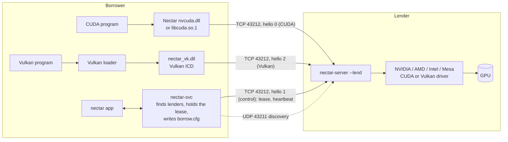

# Nectar

Lend a GPU over the network, and borrow it as if it were installed.

While a GPU is borrowed, CUDA and Vulkan programs on the borrower find it by themselves, with no launcher and no change to the program. A Vulkan program lists it as, for example, "NVIDIA GeForce RTX 5070 (Nectar)", next to the borrower's own GPU. When it's returned, or the lender goes away, programs see no GPU, as on a computer without one.

- [How it works](#how-it-works)
- [Platforms](#platforms)
- [Results so far](#results-so-far)
- [How it came together](#how-it-came-together)
- [Credits](#credits)
- [Testing still to do](#testing-still-to-do)
- [Plans](#plans)
- [Building](#building)

## How it works

### APIs, not hardware

Nectar carries **API calls**, not PCIe traffic or kernel driver calls. On the borrower, Nectar provides the driver each API's programs load:
- **CUDA:** an `nvcuda.dll` (Windows) or `libcuda.so.1` (Linux).
- **Vulkan:** a Vulkan loader driver (an ICD).

The lender runs each call on its GPU through its own, real driver. Each API is a **personality** on both sides. Everything else is shared: discovery, the shared secret, the lease, the upload cache and the transport.

WiCi measured why it has to be this level. At the kernel driver level, `nvidia-smi` alone took about 800 network round trips, 51× slower. At the API level, most calls can be sent without waiting at all.



### Lending and borrowing

- **The lender:** in the `nectar` app, **Lend this GPU** with a shared secret starts `nectar-server --lend`. The window shows who borrows the GPU, the traffic and the server's log.
- **Discovery:** the borrower broadcasts a probe on UDP 43211 with a nonce, a timestamp and an HMAC-SHA256 under the secret.
  - **Who answers:** only lenders that know the secret, each with its own HMAC over the borrower's nonce. So neither side trusts an impostor.
  - **The answer:** the lender's name, GPU vendor, OS and CPU, its state, and one line per API it lends (`api=cuda 13.5 official NVIDIA`, `api=vulkan ...`).
- **Connections** (TCP 43212): every connection starts with a challenge from the lender.
  - **Control connection** (hello 1): the borrowing service proves the secret and takes the **lease**, with a random token.
  - **CUDA and Vulkan connections** (hellos 0 and 2): programs prove the token.
  - **Not covered:** only the hello is authenticated. The calls after it are neither encrypted nor signed, so lend only on a network you trust.
- **The lease:** one borrower at a time.
  - **Heartbeats:** each way every second, carrying round-trip time and traffic.
  - **When heartbeats stop:** the borrower goes amber ("Reconnecting...") and keeps going for 20 s, so a short drop doesn't end anything. After that it goes grey ("No host available") and programs see no device. It borrows again by itself when the lender is back.
  - **On the lender:** the lease ends 30 s after the holder was last heard from with no connection open.
- **`borrow.cfg`:** the service writes it while a GPU is borrowed (`%ProgramData%\Nectar` or `/var/lib/nectar`), with the lender, the token and the APIs borrowed. The drivers read it. Users can read it; only SYSTEM or root can write it.
- **NVIDIA's hybrid runtime:** on Windows, CUDA's static runtime needs `nvcudart_hybrid64.dll`, which ships only with NVIDIA's display driver. The lender sends its own copy on the first borrow, into a sandbox keyed by its driver version. Nothing of NVIDIA's is installed system-wide on the borrower.

### The CUDA personality

- **Generated from `cuda.h`:** `codegen` runs bindgen over NVIDIA's public `cuda.h` and `cudaTypedefs.h`. It writes the types, function ids, the borrower's exports, the lender's dispatch and a tracer. Of the driver's 773 exports, 417 are generated, 33 are written by hand, 231 aren't supported yet and 92 are driver internals not in `cuda.h` (`native/nectar-cuda/codegen/report.md`).
  - Unsupported calls return `CUDA_ERROR_NOT_SUPPORTED` and log their name, instead of crashing.
  - The lender resolves every call by name through the real driver, so a driver update on the lender needs no change to Nectar.
  - After a new CUDA release, regenerating takes a run of the generator and a read of the report's diff.
- **`cuGetProcAddress`** is answered on the borrower from `cudaTypedefs.h`, with the driver's own rule: the newest variant not newer than the version asked for.
- **The runtime's private tables:** `cudart` won't start without undocumented tables from `cuGetExportTable`. The ten that ZLUDA documents, and the integrity check, are adapted from ZLUDA. Two newer ones were sized with Nectar's tracer, which observes the real driver's tables from outside: arguments, memory before and after, and results.
- **Kernels:** modules and libraries are sent as bytes. Parameter layouts come from `cuKernelGetParamInfo` / `cuFuncGetParamInfo` on the lender, cached by the borrower, never from driver internals.
- **Being loaded:**
  - **Installed:** System32's `nvcuda.dll` on Windows, or first in the library path on Linux.
  - **Without installing:** `nectar-cuda-run` loads Nectar's DLL into a program before it starts, and follows the processes it starts with a job object.
  - **On Windows:** NVIDIA's cuBLAS loads `System32\nvcuda.dll` by full path. So Nectar's DLL detours `LoadLibraryExW` (with retour) and answers any load of `nvcuda.dll` with itself.
- **Fewer waits** (`client/src/calls.rs`), which is what makes Wi‑Fi usable:
  - **No waiting:** calls that only queue work are sent without waiting, and their errors are reported at the next synchronize.
  - **Kept answers:** answers that can't change are kept, such as the context, device and kernel attributes.
  - **Batching:** requests are batched, and flushed when the borrower must wait, at 16 KiB, or after 1 ms.
  - **The upload cache:** uploads of 1 MiB or more go by content hash (XXH3-128). The lender keeps them on disk (20 GB, least recently used first out), so the second load of a model sends 16 bytes per tensor instead of 6.5 GB.
  - **No compression:** under LZ4, Q4_0 weights come to 99.6% and logits to 100.4% of their size, so it isn't worth it.
- **Safety:** the lender only runs a copy when both addresses are GPU memory. Otherwise, under unified addressing, a borrower's host address would be treated as the lender's own memory.

### The Vulkan personality

- **Generated from `vk.xml`:** `vkcodegen` reads Khronos' registry with roxmltree.
  - `vksys`: 2,430 types, with layouts checked against C sizes.
  - `vkwire`: a table describing every struct and command. One hand-written interpreter encodes and decodes them all, `pNext` chains included.
  - The lender's call thunks.
- **The borrower's driver** (`vk`, built as `nectar_vk.dll`):
  - **What it is:** a loader driver speaking interface version 5. While nothing is borrowed it lists no device.
  - **Which calls wait:** of 670 commands, 445 are sent without waiting, 220 wait for an answer, and 5 are waits the lender runs beside the ordered stream. A command is sent without waiting only when `VK_SUCCESS` is its only success code. 17 can't be carried yet, among them descriptor update templates, which DXVK needs.
  - **Design ideas from Mesa's Venus:**
    - **Handles:** the borrower chooses the ids of non-dispatchable handles, so creating one doesn't wait.
    - **Commands:** `vkCmd*` calls are recorded locally and sent with the submit.
    - **Kept answers:** properties, features and formats are fetched once and kept.
- **Mapped memory** is the hard part: the program writes to memory the GPU reads, and reads memory the GPU wrote.
  - **The shadow:** the borrower keeps a page-aligned copy of each mapping.
  - **Program writes:** on Windows, write watching (`MEM_WRITE_WATCH`) names the pages the program wrote. At submit, only those go up.
  - **GPU writes:** after a wait, the borrower's pages go **stale** (no access) instead of being fetched. The program's first touch of one fetches the stale pages around it: 1 MiB, doubling up to 64 MiB while it reads straight through. The lender (`FETCH`) sends only the pages the GPU changed. So a 566 MB staging buffer of which a token uses 1 MB costs 1 MB.
  - **Elsewhere:** Linux and macOS compare pages by hash for now. `NECTAR_VK_EAGER=1` does the same on Windows, for programs that hand mapped memory to the system.
  - **Memory types:** GPU memory the CPU can map (resizable BAR) is offered as GPU-only, since the lender's CPU would read it over PCIe. Integrated GPUs keep their memory types as they are.
- **The lender** loads the system's Vulkan loader, replays each submit into real command buffers, and frees whatever a borrower leaves behind, crashed or not.

### Detecting GPUs and drivers

`nectar-detect` lists each GPU with its vendor and PCI ids, VRAM and kernel driver, and each API its drivers offer, with version and conformance.
- **APIs checked:** CUDA, Vulkan, OpenCL, HIP and Level Zero.
- **Where each comes from:** official, community (Mesa's NVK, RADV, ANV, Honeykrisp, ...), software (lavapipe) or remote (Nectar). Vulkan drivers report this through `VkDriverId`.

The lender's discovery answer and the app's Lend screen use it.

### The code

Everything is in `native/nectar-cuda`, a Rust workspace. Its README has the settings, the tracer and the details of each crate.

| Crate | What it is |
| --- | --- |
| `protocol` | Framing, function ids, hellos, kept answers |
| `lending` | Discovery, the secret, the lease, `borrow.cfg`, the hybrid sandbox |
| `client` | The borrower's CUDA driver |
| `vk`, `vkwire`, `vksys` | The borrower's Vulkan driver, its wire format and types |
| `server` | `nectar-server`: the lender, with a CUDA and a Vulkan personality |
| `svc` | `nectar-svc`: the borrowing service (Windows service or systemd) |
| `app` | `nectar`: a window on Windows, a command elsewhere |
| `detect` | `nectar-detect` |
| `redirect`, `run`, `trace` | Windows: the `LoadLibrary` redirect, the launcher, the call tracer |
| `probe`, `vkprobe` | `cuda-probe` and `vk-probe`, end-to-end checks |
| `codegen`, `vkcodegen` | The generators, not part of the normal build |
| `install/` | The borrower's installers for Windows and Linux |
| `tests/wifi/` | The over-Wi‑Fi test kit: a bundle for the borrower, the lender's script, and the borrower's test |

## Platforms

✅ tested · 🟡 built or partly tested · ⬜ planned

| | Lender | Borrower |
| --- | --- | --- |
| **Windows x64** | ✅ CUDA, ✅ Vulkan | ✅ CUDA (over Wi‑Fi), ✅ Vulkan (loopback; Wi‑Fi next) |
| **Linux x64** | ✅ CUDA (in WSL, on NVIDIA's WSL driver), ✅ Vulkan (in WSL, on lavapipe) | ✅ CUDA, ✅ Vulkan (in WSL) |
| **Linux arm64** | 🟡 should build; waits for a cross-compiler | 🟡 same; to run under qemu, then on a Raspberry Pi 5 |
| **macOS (Apple silicon)** | ⬜ Vulkan over KosmicKrisp or MoltenVK | ⬜ Vulkan; there are no CUDA programs on macOS |
| **Windows on Arm** | ⬜ | ⬜ x64 programs under emulation, then a native ARM64X `nvcuda.dll` |
| **Android** | ⬜ | ⬜ Vulkan, for programs that load their own driver |

Lenders and borrowers mix: a Windows program has run on a Linux lender, and a Vulkan program on Windows has run on Mesa's lavapipe in Linux. One GPU vendor has been lent so far (NVIDIA, plus lavapipe in software). Intel Arc lending is the next test, from the laptop.

**Not supported, by design:**
- **Metal programs on macOS:** Metal assumes Apple's GPU.
- **Direct3D programs on Windows without a translator:** Direct3D only reaches a GPU through a WDDM kernel driver. See the plans for DXVK and vkd3d-proton.
- **Games with anti-cheat.**

## Results so far

Gemma 4 12B (Q4_0) in llama.cpp, on the desktop's RTX 5070. The chat test asks a fixed question with greedy sampling, and the answer must match the native one byte for byte.

**CUDA over Wi‑Fi** (laptop with Intel Core Ultra 9 288V on Wi‑Fi 7, desktop on Wi‑Fi 6E, 6 ms round trip, 70 MB/s up, 41 MB/s down):

| | Native on the lender | Borrowed by the laptop |
| --- | ---: | ---: |
| llama-bench pp512 | 3517 t/s | 1391 t/s (40%) |
| llama-bench tg128 | 76.5 t/s | 24.0 t/s (31%) |
| llama-server chat | 73.7 t/s | 20.8 t/s (28%), byte-identical |
| Model load | – | 95 s the first time, 11 s from the lender's cache |

A token costs about 42 ms against 13 ms natively: one round trip plus its 1 MiB of logits over the lender's Wi‑Fi upstream, which is now the limit.

**Vulkan over loopback** (llama.cpp b12030):

| | Native | Through Nectar |
| --- | ---: | ---: |
| llama-bench pp512 | 2924 t/s | 2743 t/s (94%) |
| llama-bench tg128 | 68.5 t/s | 57.9 t/s (85%) |
| llama-server chat, 506 tokens | 65.0 t/s | 51.6 t/s (79%), byte-identical |

Each Vulkan token costs about 12 waits and 2 page fetches, so over Wi‑Fi it's expected to be slower than CUDA until the waits are cut (see Plans).

PyTorch (a cuBLAS matmul and an elementwise kernel) and a CUDA runtime program also pass through Nectar, on loopback.

## How it came together

1. **Juice as the baseline:** Nectar began as a fork of Juice Labs' GPU-over-IP repository.
   - **What worked:** Juice's 2023.08.10 release rendered vkcube and the Quake II remaster on the RTX 5070, and vkcube over Wi‑Fi.
   - **What didn't:** its closed CUDA remoting depended on driver internals and failed on CUDA 13.5. Its Vulkan driver ended the program on any server error, so it couldn't be left installed.

   Juice's runtime is closed and its terms forbid redistribution and reverse engineering, so Nectar couldn't build on it.
2. **WiCi showed the way for CUDA:** remote the CUDA *driver API*, parse fatbins, and never depend on driver internals. Nectar implemented that design in Rust, in the open, under a clean-room rule: public headers and open-source projects only, with no NVIDIA or Juice binary disassembled.
   - **First:** a spike of 19 hand-written calls showed the RTX 5070 to a remote `cuda-probe`.
   - **Generator:** the generator from `cuda.h` followed.
   - **The runtime:** to start the CUDA runtime, ZLUDA's documented tables, plus a black-box tracer for the two that nobody had documented.
   - **PyTorch** needed host memory and two cuBLAS profiling hooks.
   - **llama.cpp** needed the `LoadLibrary` redirect, because cuBLAS loads the real driver by full path.
3. **The first Wi‑Fi run crawled:** 61 round trips per token and 14.9 t/s prompt processing. Sending without waiting, kept answers, batching and the upload cache brought it to about one wait per token, and the second Wi‑Fi run passed, with 28–40% of native and an identical answer.
4. **Lending became an app:** a lender window, a borrowing service, discovery with a shared secret, a lease with a grace period, and an installer. With them, CUDA programs find the borrowed GPU with no launcher.
5. **General purpose:**
   - `nectar-detect`, vendor-neutral discovery, and portable crypto.
   - A Linux port of all of it.
   - A Windows program borrowing from a Linux lender (llama.cpp, from WSL).
6. **Vulkan, the cross-vendor API:** the second personality, generated from `vk.xml`.
   - **Venus's ideas:** client-chosen handles and recorded command buffers.
   - **Mapped memory:** write watching and stale pages, after hashing a 566 MB staging buffer cost 70 ms per wait.
   - **The result:** llama.cpp's Vulkan backend reached 79–94% of native on loopback, with an identical answer.
7. **Juice removed:** none of its code was in use any more, so it was deleted. It's credited below, and its history stays in git.

## Credits

Nectar builds on other people's work: some it uses, some it adapts, and some it learned from. Each project keeps its own license.

### Inspiration and design

- **[Juice Labs](https://github.com/Juice-Labs/Juice-Labs)** (MIT, 2023): GPU-over-IP for any application. Nectar started as a fork of their repository, and their 2023.08.10 release was the first baseline. No Juice code or binaries remain, and none were disassembled.
- **WiCi** (Shen et al., [arXiv 2608.24204](https://arxiv.org/abs/2608.24204), 2026): the CUDA remoting design. The ideas Nectar took from it:
  - Intercept the CUDA driver API.
  - Take kernel parameters from the public API, not driver internals.
  - Batch calls and keep uploads on the lender.

  Its setup, a consumer GPU on Wi‑Fi, is Nectar's own, and its measurements ruled out a kernel-level forwarding driver.
- **[Mesa's Venus](https://docs.mesa3d.org/drivers/venus.html) and virglrenderer** (MIT): the Vulkan wire design. Nectar took client-assigned handles, recorded command buffers, answers kept locally, and blocking waits beside the ordered stream. No Venus code is used.
- **NVIDIA GPUDirect and NCCL:** the idea of pipelining large copies through pinned buffers (planned).

### Adapted code

- **[ZLUDA](https://github.com/vosen/ZLUDA)** (MIT/Apache-2.0): the CUDA runtime's private tables and their integrity check, with its test vectors, are adapted from ZLUDA. See `native/nectar-cuda/LICENSE-ZLUDA`. ZLUDA is also the planned way to lend an AMD GPU to CUDA programs, as the lender's CUDA driver.

### Specifications and headers

- **NVIDIA's public CUDA headers** (`cuda.h`, `cudaTypedefs.h`, under NVIDIA's license): the source of the generated CUDA bindings. Nectar's CUDA side is built from these and from NVIDIA's documentation only.
- **Khronos' [Vulkan-Headers](https://github.com/KhronosGroup/Vulkan-Headers)** (`vk.xml`, Apache-2.0 or MIT), the Vulkan specification, and the [Vulkan loader](https://github.com/KhronosGroup/Vulkan-Loader)'s driver interface.

### Used for testing

- **[llama.cpp](https://github.com/ggml-org/llama.cpp)** (MIT): the main workload, through its CUDA and Vulkan backends. The model is Google's Gemma 4 12B.
- **[PyTorch](https://pytorch.org)** (BSD-3-Clause).
- **[Mesa](https://mesa3d.org)'s lavapipe** (MIT): a software Vulkan lender in Linux.

### Rust crates

| Crate | License | Used for |
| --- | --- | --- |
| [retour](https://crates.io/crates/retour) | BSD-2-Clause | The `LoadLibraryExW` detour |
| [xxhash-rust](https://crates.io/crates/xxhash-rust) | BSL-1.0 | Content hashes for the upload cache and pages |
| [hmac](https://crates.io/crates/hmac), [sha2](https://crates.io/crates/sha2), [getrandom](https://crates.io/crates/getrandom) | MIT/Apache-2.0 | The shared secret |
| [libloading](https://crates.io/crates/libloading) | ISC | Loading GPU drivers |
| [windows-sys](https://crates.io/crates/windows-sys), [libc](https://crates.io/crates/libc) | MIT/Apache-2.0 | The operating systems |
| [roxmltree](https://crates.io/crates/roxmltree) | MIT/Apache-2.0 | Reading `vk.xml` (generator) |
| [bindgen](https://crates.io/crates/bindgen) with libclang | BSD-3-Clause; Apache-2.0 with LLVM exception | Reading `cuda.h` (generator) |
| [syn](https://crates.io/crates/syn), [quote](https://crates.io/crates/quote), [proc-macro2](https://crates.io/crates/proc-macro2), [prettyplease](https://crates.io/crates/prettyplease), [object](https://crates.io/crates/object) | MIT/Apache-2.0 | The CUDA generator |

### Planned: games and other platforms

These aren't used yet; the plans below rest on them.
- **[DXVK](https://github.com/doitsujin/dxvk)** (zlib): Direct3D 9, 10 and 11 on Vulkan. This is how Direct3D games reach a borrowed GPU on Windows.
- **[vkd3d-proton](https://github.com/HansKristian-Work/vkd3d-proton)** (LGPL-2.1): Direct3D 12 on Vulkan.
- **[Proton](https://github.com/ValveSoftware/Proton)** (Valve): on Linux, it already runs Windows games on Vulkan. With Nectar's driver installed as a system Vulkan driver, those games need no change at all.
- **[FEX](https://github.com/FEX-Emu/FEX)** (MIT): x86 programs on ARM64 Linux, as inside Proton's ARM64 builds. It carries the same path to ARM devices.
- **[Mesa's Zink](https://docs.mesa3d.org/drivers/zink.html)** (MIT): OpenGL on Vulkan.
- **[KosmicKrisp](https://docs.mesa3d.org/drivers/kosmickrisp.html)** (Mesa, MIT) and **[MoltenVK](https://github.com/KhronosGroup/MoltenVK)** (Apache-2.0): Vulkan on Apple GPUs, for a Mac lender. Also LunarG's Vulkan SDK for macOS, for building there.
- **[ProtonDB](https://www.protondb.com)** (its data under ODbL) and **[AreWeAntiCheatYet](https://areweanticheatyet.com)**: which games to test, and which to leave out.

## Testing still to do

**Next, with what's here now:**
- **The Vulkan Wi‑Fi run:** the laptop borrows the RTX 5070 with the current bundle (`native/nectar-cuda/tests/wifi`). It also tests things that have only run on loopback so far:
  - The installed borrower: `Install-Borrower.ps1`, the service under Windows' service manager, and the Vulkan driver registered with the loader.
  - CUDA programs with no launcher at all.
- **Drops on the installed borrower:**
  - A 2 s Wi‑Fi drop stays green or amber and recovers.
  - A long drop goes grey, programs see no GPU, and it borrows again when the link is back.
  - `-Uninstall` leaves nothing behind.
- **A second vendor:** the desktop borrows the laptop's **Intel Arc** through Vulkan.
- **Vulkan conformance:** Khronos' CTS (dEQP-VK `api.*` and `memory.*`) over loopback on Windows and in WSL, with failures listed, not hidden.
- **Regression on each change:** `cuda-probe`, `vk-probe`, `runtime_probe.cu`, `torch_probe.py` and the llama.cpp chat on both APIs. `cargo test` and `clippy` on Windows and Linux.

**Needs other machines:**
- **The Mac** (Apple silicon), over SSH from the desktop:
  - Borrowing the RTX 5070 from an ARM64 macOS program.
  - Lending the Apple GPU to Windows through KosmicKrisp.
- **Linux on real hardware:** `install-borrower.sh` and the systemd service outside WSL, and discovery by broadcast, which doesn't reach into WSL.
- **arm64 Linux:** cross-built and run under qemu, then on a Raspberry Pi 5.
- **Windows on Arm:**
  - x64 CUDA programs under emulation, and whether the `LoadLibrary` detour works there.
  - Then native Arm64 programs.
- **An AMD GPU:** HIP, and CUDA programs through ZLUDA on the lender.
- **A different-version hybrid runtime:** whether a Windows borrower can use one from a lender whose driver version differs, or one from a Linux lender.

**Known gaps to close and then test:**
- **Linux and macOS mapped memory:** pages are still compared by hash. They need write and touch tracking (`mprotect` or `userfaultfd`).
- **Vulkan model loads:** they don't use the upload cache yet, so each load sends the whole model.
- **Stale pages:** a program that passes stale mapped memory to the system (for example `WriteFile`) fails. `NECTAR_VK_EAGER=1` is the workaround.
- **More than one borrower:** it needs fair sharing on the lender first.

## Plans

**Vulkan, finishing compute (milestone 3.2):**
- **Fewer waits:** answer waits for copy-only submits on the borrower, with the lender holding later writes to that memory until the copy is done.
- **The upload cache** for Vulkan.
- **Page tracking** on Linux and macOS.

**Frames on screen (3.3), after a go/no-go on the Wi‑Fi numbers:**
- **The borrower:** surfaces and swapchains handled on the borrower, and the lender renders into its own images.
- **On present:** the lender encodes the frame as video (Vulkan Video, or NVENC, AMF or QSV), and the borrower decodes and draws it.
- **Fewer waits:** fences and acquires answered locally where it's safe, so a frame costs about one wait.
- **Done when:** vkcube runs on the laptop and the Mac, with frame rate and input-to-photon latency measured.

**Games (3.4):**
- **Windows:** DXVK beside a Direct3D 11 game with no anti-cheat, then Direct3D 12 through vkd3d-proton, then a native Vulkan game. Descriptor update templates come first, since DXVK needs them.
- **Linux:** Steam with Proton and Nectar as the system Vulkan driver, with no change to the game. OpenGL through Zink.
- **ARM Linux:** Proton ARM64 with FEX.
- **A per-game compatibility list,** from Valve's Deck ratings, ProtonDB and AreWeAntiCheatYet, plus Nectar's own results.

**Other vendors and platforms** (`docs/general-purpose.md`):
- **A signed driver catalog** and `nectar doctor`: what each GPU and OS needs, official or community, from where, with pinned hashes. Nectar never installs kernel drivers.
- **AMD:** a HIP personality.
- **Apple:** a Mac lender and borrower.
- **Windows on Arm:** native.
- **Android.**

**Windows integration:**
- **Task Manager:** a compute-only presence driver, so the borrowed GPU shows there, if three checks in a test-signed VM pass (`docs/driver/wddm-render-driver.md`).
- **Xbox-app games:** they need a full WDDM driver, so they're the last test of the graphics track.

**Open hardware lender:** an appliance that lends a GPU over OCuLink.
- **The host:** a small x86 or ARM64 computer running Linux.
- **The management controller:** runs Zephyr for power, fans and the discovery beacon, and serves the signed driver catalog and borrower packages even while the host is off. The spec will be under CERN-OHL-S-2.0.

**Faster links:** Ethernet or a better Wi‑Fi card on the lender. A CUDA token over Wi‑Fi is now limited by the lender's upstream.

## Building

On Windows, with Rust installed:

```powershell
.\Build-All.ps1
```

The files land in `build\nectar-cuda`. On Linux, run `cargo build --release` in `native/nectar-cuda`. To borrow from another computer, follow `native/nectar-cuda/tests/wifi/README.md`.

## License

MIT; see `LICENSE.md`. Adapted code keeps its own license notice (`native/nectar-cuda/LICENSE-ZLUDA`).
